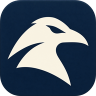

<p align="center">
  
</p>

<h1 align="center">Gustaf</h1>

<p align="center">Runs coding agents on your computer, with the subscriptions you already have.</p>

Gustaf runs the coding agents on your machine and gives them one fast interface. Start a thread at your desk, then follow and steer it from the web or from your phone.

Gustaf is an unofficial fork of the open-source [T3 Code](https://github.com/pingdotgg/t3code). It is not affiliated with T3 Tools, Inc. See [Trademarks and forks](#trademarks-and-forks).

It works with Claude Code, Codex, Cursor, OpenCode, Grok Build, Antigravity, Kiro, Pi, Muse Code, fx, and any [ACP](./docs/user/providers-acp.md) agent. If an agent is set up on your computer, Gustaf can control it.

## What you get

- **Your subscriptions.** Gustaf does not resell tokens. It drives the agents you are already signed in to.
- **Every agent in one place.** Change models in the middle of a thread. Let Claude hand a task to Codex.
- **Desktop, web, and phone.** One server, and every client shows the same threads.
- **Remote ready.** Run agents on any machine. Connect over your local network, Tailscale, or a tunnel (see [Remote access](./docs/user/remote-access.md)).
- **Git built in.** Each thread can work in its own worktree. Review the diff, then commit, push, and open a pull request with one button.
- **Open.** Source code is MIT licensed.

## Install

Get the latest desktop app from [GitHub Releases](https://github.com/Libes6/Gustaf/releases/latest) for macOS, Windows, or Linux. Each release lists the checksums of its files.

The Gustaf desktop app is built on Electron. It runs the server locally and checks the same releases for updates.

### Sign in to an agent

Gustaf needs one agent that is installed and signed in. For example, install [Claude Code](https://claude.com/product/claude-code) and run `claude auth login`, or install the [Codex CLI](https://developers.openai.com/codex/cli) and run `codex login`.

[Provider setup](./docs/user/install.md#providers) has the steps for each agent.

## Build from source

Gustaf uses [Vite+](https://viteplus.dev/guide/). Install its global `vp` command, which also provides the pinned Node version.

```bash
vp i                 # install dependencies
vp run dev           # server and web client
vp run dev:desktop   # Electron desktop app
```

Read the [development runbook](./docs/operations/00_development.md#first-checkout) first. The [architecture overview](./docs/internals/01_architecture.md) explains how the pieces fit, and the mobile app lives in [`apps/mobile`](./apps/mobile/README.md).

## Documentation

- [Install and first run](./docs/user/install.md)
- [Remote access from a phone or another machine](./docs/user/remote-access.md)
- [Permission modes](./docs/user/permission-modes.md)
- [Source control](./docs/user/source-control.md)
- [Connect outside agents over MCP](./docs/user/outside-agents.md)
- [FAQ](./docs/user/faq.md)

[All docs](./docs/README.md) has the full list.

## License

The source code in this repository is licensed under the [MIT License](./LICENSE).

## Trademarks and forks

Gustaf is built from the source code of T3 Code. The MIT license applies **only to the source code**. It does not grant any rights to T3 Tools, Inc.'s trademarks, branding, or trade dress. Gustaf uses its own name and icon, and nothing here suggests official status or affiliation with T3 Tools, Inc.

See [TRADEMARK.md](./TRADEMARK.md) for the full trademark and branding policy.
